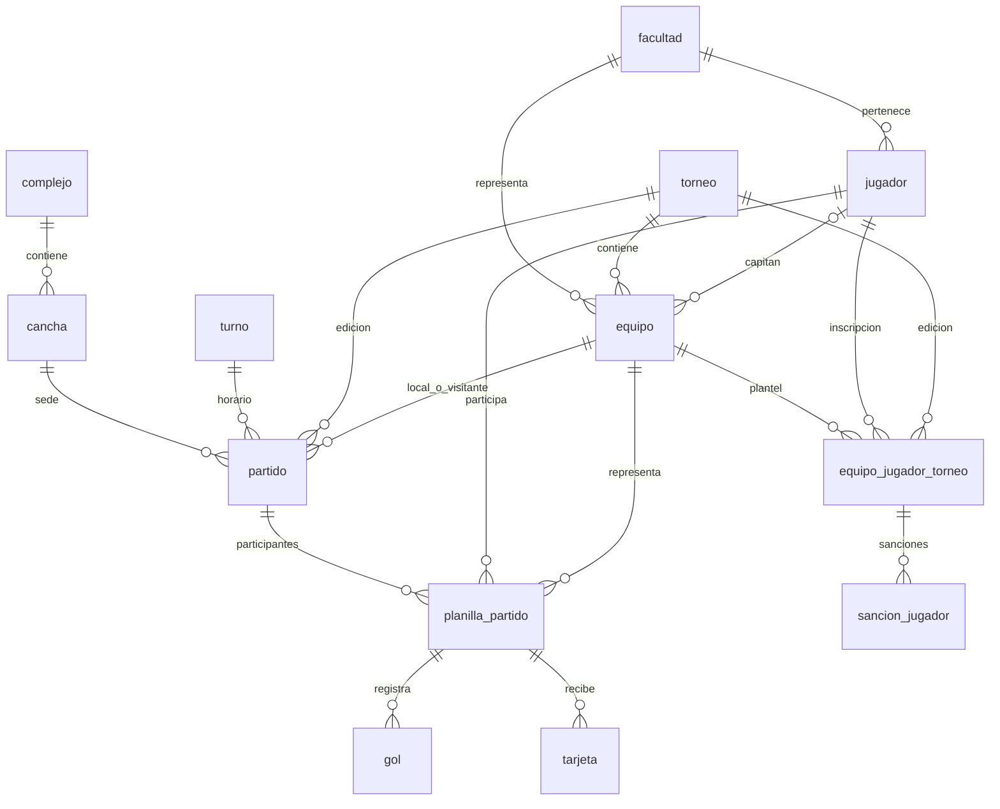

# Recorrido del modelo

`login` autentica los dos roles; no identifica a los jugadores ni está ligado a una CI.
El diagrama describe relaciones, no todas las reglas deportivas. Ver `01_esquema.sql` para PK/FK y `REQUISITOS.md` para las reglas todavía pendientes.

## Lectura de un resultado

Partido → planilla → gol. La planilla informa el equipo del jugador. Si autogol es falso, el gol suma a ese equipo; si es verdadero, suma al rival. Las vistas de resultados y actuaciones permiten calcular la tabla de posiciones sin almacenar marcadores duplicados.

## Identidad e historia

La CI identifica una persona. `equipo_jugador_torneo` agrega la edición y el equipo de esa persona, sin crear un jugador nuevo por cada torneo. Los datos del avance mantienen una única facultad/tipo por persona; por ahora se bloquea su modificación cuando existe una inscripción.
